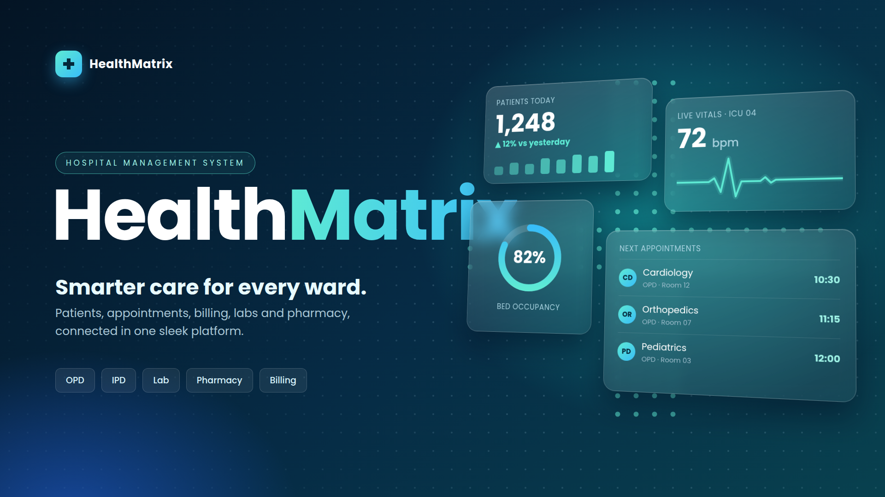

<!-- ANIMATED HEADER -->
<div align="center">


<a href="https://YOUR-SITE-NAME.netlify.app">
  
</a>

<br/>

[](https://mayankporfoliowebsite.netlify.app/)
[](assets/resume.pdf)
[](https://mayankporfoliowebsite.netlify.app/contact.html)


</div>


## ✨ About This Project

> A fast, hand-crafted personal portfolio built with **pure HTML, CSS, and vanilla JavaScript**: no frameworks, no build step, no bloat. Designed for speed, polish, and a premium feel.

This site brings together who I am, what I've built, and how I think about engineering. It features a custom maroon-and-gold visual identity, smooth micro-interactions, and a fully responsive layout.

<!-- PREVIEW: add a screenshot at assets/preview.png, then uncomment the line below -->
<!-- <div align="center"></div> -->


## 🧭 Site Map

| | Page | What you'll find |
|:-:|------|------------------|
| 🏠 | [`index.html`](index.html) | Landing page and introduction |
| 👤 | [`about.html`](about.html) | My story, background, and what drives me |
| 💼 | [`work.html`](work.html) | Featured projects and case studies |
| 🛠️ | [`capabilities.html`](capabilities.html) | Skills and technologies I work with |
| 📬 | [`contact.html`](contact.html) | Ways to reach me |


## 🚀 Featured Projects

<div align="center">
<table>
<tr>
<td align="center" width="33%">
<br/>
<h3>🩺 HealthMatrix</h3>
<sub>Add a one-line description here.</sub>
</td>
<td align="center" width="33%">
<br/>
<h3>📈 TradeWell</h3>
<sub>Add a one-line description here.</sub>
</td>
<td align="center" width="33%">
<br/>
<h3>🏨 TripStay</h3>
<sub>Add a one-line description here.</sub>
</td>
</tr>
</table>
</div>

<div align="center">

[**Explore all projects →**](https://YOUR-SITE-NAME.netlify.app/work.html)

</div>


## 🧰 Tech & Skills Showcased

<div align="center">

**Languages & Frontend**


**Backend & APIs**


**Databases & Caching**


**DevOps & Cloud**


**Testing**


</div>

<details>
<summary><b>🤖 Also on the site: AI / ML & fundamentals</b></summary>
<br/>

- **GenAI, LLMs, RAG, and AI Agents**
- **Machine Learning**
- **System Design** and **Data Structures & Algorithms**
- **REST API design**, **CI/CD**, and **message queues (BullMQ)**

</details>


## 🎯 Highlights

- ⚡ **Blazing fast**: zero framework overhead, instant load
- 📱 **Fully responsive**: pixel-perfect on mobile, tablet, and desktop
- 🎨 **Custom design system**: maroon and gold identity with premium polish
- 🎬 **Smooth animations**: subtle, purposeful micro-interactions
- 🔄 **Continuous deployment**: every push to `main` goes live automatically
- 📄 **Downloadable resume** built right in


## 📁 Project Structure

```bash
Porfolio-Website/
├── index.html            # Landing page
├── about.html            # About me
├── work.html             # Projects
├── capabilities.html     # Skills
├── contact.html          # Contact
├── css/
│   ├── style.css         # Global styles
│   ├── pages.css         # Inner page styles
│   ├── work.css          # Work page styles
│   └── premium.css       # Premium visual polish
├── js/
│   ├── main.js           # Global interactions
│   ├── pages.js          # Inner page logic
│   ├── work.js           # Work page logic
│   └── premium.js        # Premium animations
└── assets/
    ├── icons/            # Tech icons (SVG)
    ├── projects/         # Project cover images
    ├── Profile.png
    └── resume.pdf
```

## ⚙️ Run Locally

No install and no build step.

```bash
git clone https://github.com/mayank5463/Porfolio-Website.git
cd Porfolio-Website
```

Then open `index.html` in your browser, or use the **Live Server** extension in VS Code, or run:

```bash
npx serve .
```

## 🌐 Deployment

Hosted on **Netlify** and linked to this repo. Every push to `main` triggers an automatic redeploy.

```bash
git add .
git commit -m "Describe your change"
git push
```


## 📊 GitHub Stats

<div align="center">


<!-- Contribution snake: requires the workflow in .github/workflows/snake.yml (see setup notes) -->
<!--

-->

</div>


## 🤝 Let's Connect

I'm open to opportunities, collaborations, and good conversations about building software.

<div align="center">

[](https://github.com/mayank5463)
[](https://linkedin.com/in/YOUR-HANDLE)
[](mailto:your.email@example.com)
[](https://YOUR-SITE-NAME.netlify.app)

</div>

## 📜 License

© Mayank. All rights reserved. The code is shared for reference. Please don't reuse the design, content, or personal assets (photos, resume, project covers) without permission.

<div align="center">

⭐ **If you like this site, consider starring the repo!** ⭐

</div>


